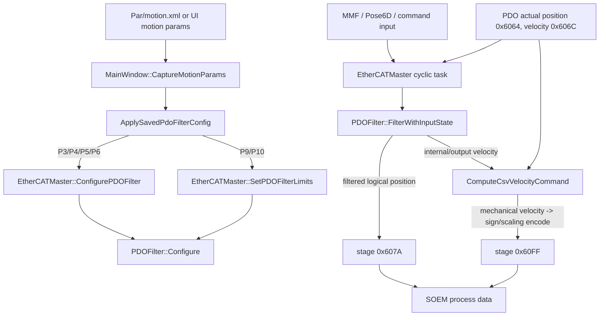
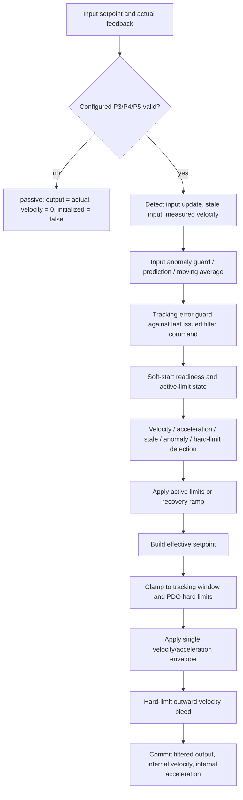
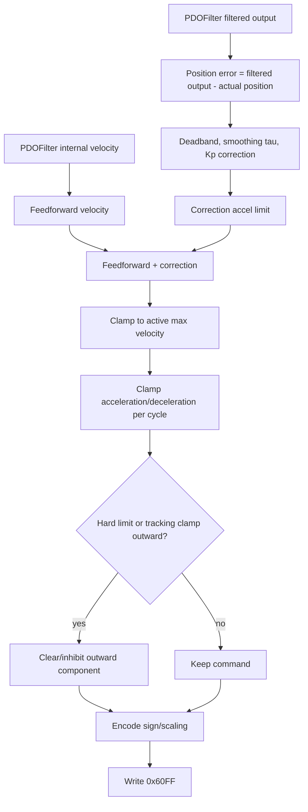
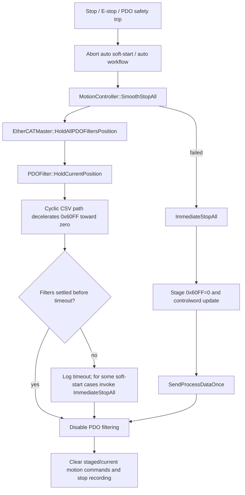

# EtherCAT CSP to CSV and PDOFilter Flow

Last verified: 2026-05-13.

This document describes the current implementation, not an idealized CiA402 design. In this project the default cyclic mode is CSV, CiA402 mode 9, and the active cyclic command PDO is `0x60FF Target Velocity`. `0x607A Target Position` is still staged as a logical target, telemetry channel, and safety reference, but the drive follows `0x60FF` in normal CSV operation.

Primary code anchors:

- `include/core/Cia402Mode.h`: default mode and command PDO.
- `src/ui/MainWindow.Motion.cpp`: motion parameter capture and PDOFilter configuration.
- `src/ethercat/PDOFilter.cpp`: filter state machine and safety envelopes.
- `src/ethercat/EtherCATMaster.Cyclic.cpp`: CSV velocity command generation and PDO writes.
- `src/motion/MotionController.cpp`: smooth/immediate stop staging.
- `src/ui/MainWindow.Command.cpp`: auto stop, emergency stop, and filter-disable flow.

## CSP to CSV Summary

| Topic | CSP behavior | Current CSV behavior | Project impact |
| --- | --- | --- | --- |
| CiA402 mode | Mode 8, cyclic synchronous position | Mode 9, cyclic synchronous velocity | Default cyclic motion now drives velocity. |
| Active drive command | `0x607A Target Position` | `0x60FF Target Velocity` | A stale nonzero velocity command is more dangerous than a stale position command. |
| Logical target | Same as drive command | `0x607A` remains logical target/telemetry | UI/logs can still compare target position, filter output, and actual position. |
| Host responsibility | Host sends position trajectory | Host computes a velocity command from filter feedforward plus position-error correction | More control in host; more responsibility for stop and watchdog behavior. |
| Drive responsibility | Drive follows cyclic position interpolation | Drive follows cyclic velocity command using its internal velocity loop | Field behavior depends more on drive velocity-loop tuning and velocity scaling. |

## Benefits in This Project

1. Better control of command velocity. The project can clamp the actual `0x60FF` command every cycle using P3/P4/P5-derived envelopes, hard-limit direction checks, and tracking-error inhibit logic.

2. Safer hard-limit behavior than blindly issuing position targets. When actual or filtered output reaches a PDO hard limit, outward CSV velocity is cleared and the current IOmap `0x60FF` bytes are refreshed immediately.

3. Smooth-stop can hold the filter at the current logical position while reducing the velocity command toward zero. The stop path is no longer dependent on sending a new far-away position target.

4. The RT scope can separate intent from actuation: `0x607A`/filter output shows the logical target, while `0x60FF` shows the actual velocity command.

5. CSV is more tolerant of small logical-target discontinuities when the correction and acceleration envelopes are tuned correctly, because the final command to the drive is velocity-limited.

## Costs and Drawbacks

1. Stop safety is more sensitive to stale commands. If the cyclic path or EtherCAT communication stops after a nonzero `0x60FF` is sent, a drive can continue moving until its watchdog, quick stop, disable operation, or hardware safety layer intervenes.

2. The host now owns a position-loop layer. `ComputeCsvVelocityCommand()` combines filter feedforward, a smoothed position-error correction, acceleration limiting, and hard-limit direction inhibition. Bad gain or sign assumptions can create lag, ringing, or runaway-looking behavior.

3. CSV requires correct sign handling. The project must compare mechanical-direction velocity before PDO encoding. Inverted axes with `P2=1` use the opposite raw sign for the same mechanical direction.

4. More safety states must be kept coherent. `PDOFilter`, staged outputs, IOmap bytes, simulation behavior, UI emergency stop, and filter-disable all have to agree on `0x607A` and `0x60FF`.

5. P6 is not currently an active jerk limiter. It is parsed and stored for API/config compatibility, but the current CSV-safe filtering path uses immediate acceleration/deceleration envelopes rather than enforcing jerk-limited motion.

## Safety Concerns and Stop Failure Risk

CSV does not automatically make stopping unsafe, but it changes the failure mode. In CSP, a stale command often means the drive holds or continues toward the last target position. In CSV, a stale nonzero `0x60FF` can continue commanding motion.

| Risk | Current protection | Residual concern |
| --- | --- | --- |
| PDO filtering disabled while velocity is nonzero | Disable paths clear staged outputs and current IOmap bytes for both `0x607A` and `0x60FF`. | Must stay covered by regression tests because this is a core CSV safety invariant. |
| Smooth stop requested while MMF target remains far away | `SmoothStopAll()` calls `HoldAllPDOFiltersPosition()`, causing filters to ignore MMF input and decelerate/hold. | If the filter cannot settle in time, the flow proceeds to disable filtering; the disable path must continue zeroing `0x60FF`. |
| Smooth stop fails | `ImmediateStopAll()` stages `0x60FF=0`, stages a controlword change, and sends one process-data frame. | The current helper names the controlword update as QS but sets bit `0x0004` high. Confirm against the target drive's CiA402 quick-stop polarity before treating this as a verified drive-level quick stop. |
| Hard PDO limit reached | Filter clamps output to `[iMinPDO_, iMaxPDO_]`; CSV command generation clears outward velocity by mechanical direction and writes current IOmap bytes. | Hardware limit switches/STO should still be the final safety layer. Software hard limits are not a substitute. |
| Tracking error persists | Normal online tracking error can latch fatal after 0.5 s and route to auto emergency stop. Soft-start saturated tracking is not treated as fatal while healthy convergence is happening. | If feedback is stale or wrong-sign, the software may make the wrong decision until fault detection catches it. |
| EtherCAT communication loss or cyclic thread stall | Existing master/network fault handling and drive watchdogs are expected to catch communication failure. | The safety case must verify drive-side watchdog/quick-stop decel and hardware E-stop/STO. Do not rely on Windows scheduling alone. |
| Sign inversion error | Current hard-limit CSV inhibit uses mechanical `csvVelocityCommand` before raw PDO sign encoding. | Any future low-level velocity comparison must preserve this mechanical-direction rule. |

Safety conclusion: CSV is acceptable only if `0x60FF` zeroing, drive watchdogs, quick-stop/disable-operation behavior, software hard limits, and hardware E-stop/STO are all treated as separate layers. The project has software mitigations for the known CSV stale-velocity hazards, but field validation must confirm the drive-level quick-stop polarity, watchdog timeout, and deceleration behavior.

## Current Control Architecture

### One PDOFilter Cycle

### CSV Velocity Command Cycle

### Stop and Emergency Stop Flow

## Effective Active Limits

| State | Active max velocity | Active acceleration | Active deceleration | Notes |
| --- | ---: | ---: | ---: | --- |
| Normal online | P3 | P4 | P5 | Configured values are not scaled. |
| Soft-start | P3 * 0.14 | P4 * 0.20 | P5 * 0.20 | Soft-start active limits are intentionally lower than configured values. |
| Dynamic velocity/accel/stale/anomaly limiting | dynamic cap, normally around P3 * 0.60 | P4 * 0.20 | P5 * 0.20 | Dynamic cap is clamped between soft-start velocity and configured velocity. |
| Hard PDO limit | P3 * 0.14 | P4 * 0.20 | P5 * 0.20 | Uses stricter crawl envelope and clears outward CSV velocity. |
| Recovery after limiting or soft-start | ramps back to P3 over 3 s | ramps back to P4 over 3 s | ramps back to P5 over 3 s | Linear ramp from current active values to configured values. |

Important distinction: `GetConfiguredMaxAcceleration()` and `GetConfiguredMaxDeceleration()` report P4/P5 as configured. `GetMaxAcceleration()` and `GetMaxDeceleration()` report active state-dependent values, which can be reduced during soft-start or limiting.

## Parameter Map

### Motion Parameters from `motion.xml` / UI

| Parameter | Current role in CSV path | Actual effect |
| --- | --- | --- |
| P1 | Scale/display-related motion parameter in the saved snapshot path | Logged with P9/P10; not the main CSV command limit. |
| P2 | Axis inversion flag | Affects raw PDO sign encoding. Safety checks must use mechanical direction before encoding. |
| P3 | Configured max velocity | Used as normal `iConfiguredMaxVelocity_` and active `iMaxVelocity_` baseline. |
| P4 | Configured max acceleration | Used as normal acceleration limit and as source for soft-start/limiting ratios. |
| P5 | Configured max deceleration | Used as normal deceleration/braking limit and as source for soft-start/limiting ratios. |
| P6 | Configured jerk input | Parsed and stored as `iJerk_`, but not enforced as an active jerk limiter in the current filter path. |
| P9/P10 | PDO position limits | Applied through `SetPDOFilterLimits()` when both are present and reasonable. |

### PDOFilter Internal Defaults

| Item | Default | Adjustable without code change? | Effect |
| --- | ---: | --- | --- |
| Cycle time fallback | 0.002 s | Indirectly via master desired cycle time | Used for per-cycle velocity/acceleration integration. |
| Position gain | 70.0 | API `SetPositionGain()` | Auxiliary steady-state position-error correction. CSV motion should be driven primarily by filter velocity feedforward plus bounded damping. |
| Position deadband | 0.00001 | API `SetPositionDeadband()` | Position error below this is treated as zero. |
| Soft-start velocity ratio | 0.14 | Code constant | Active P3 during soft-start. |
| Soft-start accel/decel ratio | 0.20 | Code constant | Active P4/P5 during soft-start and several safety limiting states. |
| Soft-start position tolerance | 0.1 deg | Code constant | Axis must be within this window before ready timer can complete. |
| Soft-start settle time | 0.05 s | Code constant | Required stable time inside tolerance. |
| Soft-start velocity blend time | 0.05 s | Code constant | Blends input after soft-start completion. |
| Active-limit recovery ramp | 3.0 s | Constructor value only | Restores active limits to configured P3/P4/P5. |
| Input moving average size | 10 samples | Code constant | Smooths setpoint input in normal mode. |
| Velocity moving average size | 16 samples | Code constant | Smooths velocity used for violation detection. |
| Extrapolation history size | 5 samples | Code constant | Used for short stale-input prediction. |
| Stale prediction window | 50 cycles | Code condition | Allows short prediction before treating no-update input as stale. |

### Violation and Safety Thresholds

| Item | Default | Effect |
| --- | ---: | --- |
| Velocity violation threshold | P3 * `DynamicVelocityThresholdScale` (0.60) | Sustained raw input velocity above this can engage limiting. |
| Acceleration threshold | P4 * `DynamicAccelerationThresholdScale` (1.20) | Sustained positive acceleration above this can engage limiting. |
| Deceleration threshold | -P5 * `DynamicAccelerationThresholdScale` (1.20) | Sustained negative acceleration below this can engage limiting. |
| Accel/decel violation delay | `DynamicAccelerationViolationDelaySec` (0.20 s) | Delay before accel/decel limiting engages. |
| Velocity violation delay | `DynamicVelocityViolationDelaySec` (0.50 s) | Delay before velocity limiting engages. |
| Stale input violation delay | 1.0 s | Delay before no-update input is treated as violation when update state is unknown. |
| Input anomaly violation delay | 0.5 s | Delay before persistent anomalous jumps become formal violation. |
| Recovery no-violation delay | 3.0 s | Time clean before local limiting begins recovery ramp. |
| Tracking window during soft-start | 5 deg | Soft-start command/feedback guard. |
| Tracking window normal online | 15 deg | Normal command/feedback guard. |
| Fatal tracking delay | 0.5 s | Normal online tracking error can latch fatal after this time. |

The four dynamic velocity/acceleration values above are loaded from the executable-side `BigCat.ini` `[PDOFilter]` section when PDO filters are configured. Missing files or missing keys are generated with the defaults shown here.
| Tracking shrink tolerance | 0.25 deg | Used to decide whether saturated tracking is improving. |

### CSV Correction Defaults

| Item | Default | Effect |
| --- | ---: | --- |
| Correction smoothing tau | 0.025 s | Low-pass for position error before Kp correction. |
| Correction acceleration ratio | 0.5 | Correction velocity changes at half of active accel/decel envelope. |
| Position correction gain ratio | 0.18 | Real EtherCAT position P correction is reduced so velocity feedforward remains the primary drive. |
| Soft-start pull-in gain ratio | 0.35 | Used only while soft-start is still active and feedforward has settled near zero, so axes can enter the ready window. |
| Hold correction gain ratio | 0.08 | Further reduces position correction after soft-start or when feedforward is near zero. |
| Correction velocity cap | 0.20 * active max velocity | Keeps position correction auxiliary to feedforward. |
| Soft-start pull-in velocity cap | 0.40 * active max velocity | Gives soft-start a bounded final pull-in without making P correction the main moving command. |
| Hold correction velocity cap | 0.08 * active max velocity | Prevents held targets from issuing oscillatory CSV velocity. |
| Soft-start correction gain multiplier | 0.1 | Reduces position correction during soft-start. |
| Soft-start correction velocity margin | 1.35 | Caps correction velocity relative to soft-start max velocity. |
| Simulation position-gain scale | 0.30 | Additional simulation-only reduction applied on top of the bounded correction ratios. |

## How to Align Charts with Actual Motion

Use these signals when comparing RT scope, logs, and field behavior:

| Signal | Meaning in current CSV implementation |
| --- | --- |
| `tPos` / `0x607A` | Logical target position and telemetry. Not the active CSV motion command. |
| `tVel` / `0x60FF` | Active CSV velocity command sent to the drive. This is the primary actuation signal. |
| `aPos` / `0x6064` | Actual feedback position, normalized/unwrapped before entering the filter path. |
| `aVel` / `0x606C` | Actual feedback velocity from PDO. |
| `filter` | `PDOFilter::GetFilteredOutput()`, logical filtered target. |
| `filterVel` | `PDOFilter::GetInternalVelocity()`, internal planned velocity after filter commit. |
| `filterAcc` | `PDOFilter::GetInternalAcceleration()`, internal planned acceleration after filter commit. |

Expected patterns:

1. During normal online motion, active P3/P4/P5 should match configured values. If active P4/P5 shows 20%, check whether soft-start, hard-limit, or dynamic limiting is active.

2. During soft-start, `filter` should move from actual position toward the logical target under `P3 * 0.14` and `P4/P5 * 0.20`; `0x60FF` should remain bounded by the tightened startup envelope.

3. During smooth stop, `HoldCurrentPosition()` makes the filter ignore the external MMF target. `filterVel` and `0x60FF` should decay toward zero rather than continuing toward the old MMF target.

4. During hard-limit protection, outward mechanical velocity should be zeroed. For inverted axes, inspect mechanical direction before raw encoded sign.

5. P6 should not be used as proof of jerk limiting. If jerk-limited behavior is required, it needs a deliberate design change and field validation because earlier jerk smoothing attempts distorted filter position output.

## Verification Checklist for Future Changes

- Confirm default mode remains CSV mode 9 and active command PDO remains `0x60FF`.
- Confirm disabling PDO filtering clears staged and current IOmap bytes for both `0x607A` and `0x60FF`.
- Confirm hard-limit checks compare mechanical-direction velocity, not raw encoded sign.
- Confirm `GetConfigured*` diagnostics use configured getters, and active `GetMax*` diagnostics are labelled as active values.
- Confirm stop tests show `0x60FF` reaches zero even if MMF input remains nonzero.
- Confirm drive-side watchdog, quick-stop polarity, quick-stop decel, and hardware STO/E-stop behavior on real hardware.
