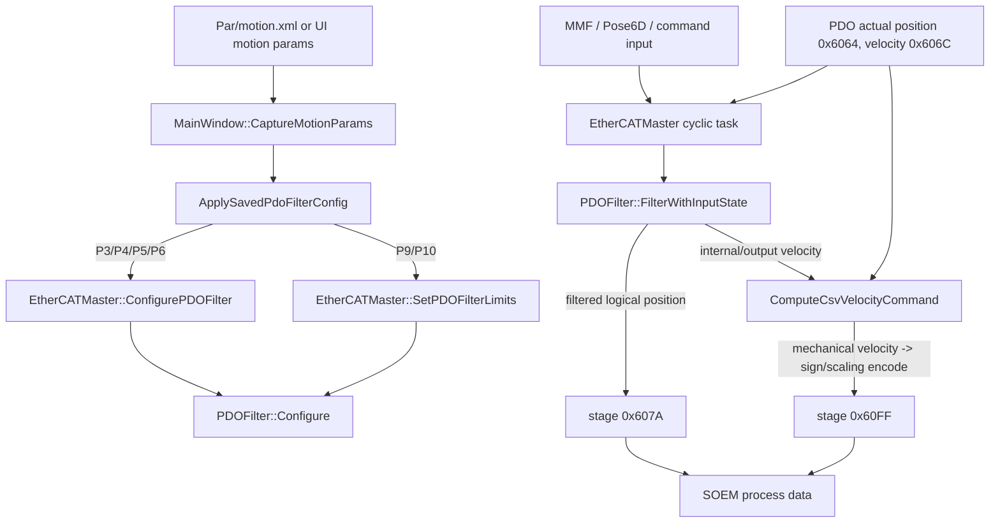
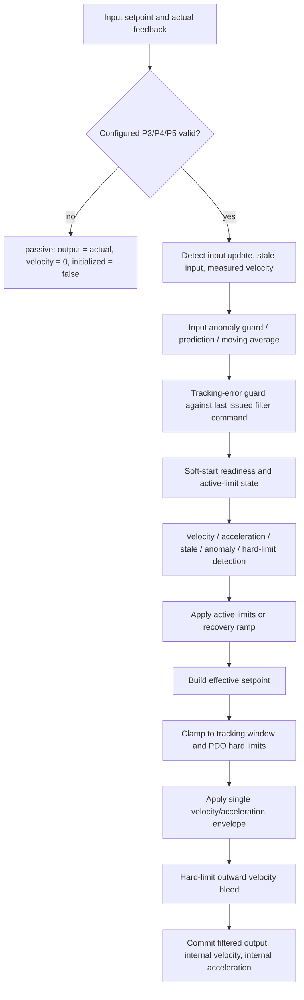
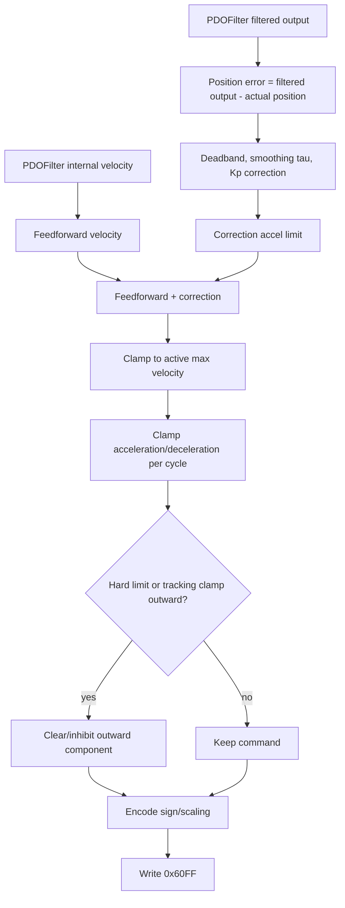
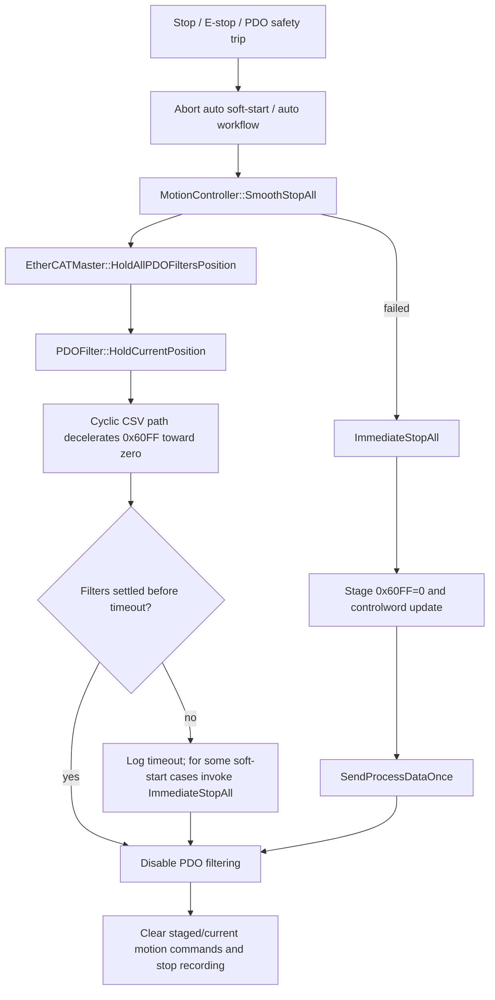

# EtherCAT CSP 到 CSV 與 PDOFilter 流程

最後驗證：2026-05-13。

本文件描述目前實作，而非理想化的 CiA402 設計。在此專案中，預設循環模式為 CSV，即 CiA402 模式 9，主要循環命令 PDO 為 `0x60FF Target Velocity`。`0x607A Target Position` 仍保留為邏輯目標、遙測通道與安全參考，但驅動器在正常 CSV 運作時會遵循 `0x60FF`。

主要程式碼定位：

- `include/core/Cia402Mode.h`：預設模式與命令 PDO。
- `src/ui/MainWindow.Motion.cpp`：運動參數擷取與 PDOFilter 設定。
- `src/ethercat/PDOFilter.cpp`：濾波器狀態機與安全包絡。
- `src/ethercat/EtherCATMaster.Cyclic.cpp`：CSV 速度命令產生與 PDO 寫入。
- `src/motion/MotionController.cpp`：平順/立即停止階段。
- `src/ui/MainWindow.Command.cpp`：自動停止、緊急停止與濾波器禁用流程。

## CSP 到 CSV 概要

| 主題 | CSP 行為 | 目前 CSV 行為 | 專案影響 |
| --- | --- | --- | --- |
| CiA402 模式 | 模式 8，循環同步位置 | 模式 9，循環同步速度 | 預設循環運動以速度驅動。 |
| 主動驅動命令 | `0x607A Target Position` | `0x60FF Target Velocity` | 殘留的非零速度命令比殘留位置命令更危險。 |
| 邏輯目標 | 與驅動命令相同 | `0x607A` 保留為邏輯目標/遙測 | UI/日誌仍可比較目標位置、濾波輸出與實際位置。 |
| 主機責任 | 主機發送位置軌跡 | 主機從濾波前饋加位置誤差修正計算速度命令 | 主機控製增加；停止與看門狗行為責任也增加。 |
| 驅動責任 | 驅動器遵循循環位置插補 | 驅動器遵循內部速度環的循環速度命令 | 現場行為更依賴驅動器速度環調整與速度縮放。 |

## 本專案優勢

1. 速度命令掌握更精確。專案可在每次循環中使用 P3/P4/P5 衍生的包絡線、硬限方向檢查和追蹤誤差抑制邏輯，對實際 `0x60FF` 命令做保護。

2. 比盲目發出位置目標更安全的硬限處理。當實際或過濾輸出達到 PDO 硬限時，外向 CSV 速度會被清除，並立即刷新目前 IOmap `0x60FF` 位元組。

3. 平順停止可在減小速度命令至零的同時，將濾波器保持在當前邏輯位置。停止路徑不再依賴發送新的遠端位置目標。

4. RT 示波器可以區分意圖與執行：`0x607A`/濾波輸出顯示邏輯目標，而 `0x60FF` 顯示實際速度命令。

5. 當修正與加速包絡調校正確時，CSV 對小邏輯目標不連續性更容忍，因為送到驅動器的最終命令受速度限制。

## 成本與缺點

1. 停止安全對殘留命令更敏感。若循環路徑或 EtherCAT 通信在發出非零 `0x60FF` 後停止，驅動器可能持續移動直到其看門狗、快速停止、禁用運行或硬體安全層介入。

2. 主機現在承擔位置環層。`ComputeCsvVelocityCommand()` 結合濾波前饋、平順位置誤差修正、加速限制與硬限方向抑制。錯誤的增益或符號假設會造成滯後、振鈴或貌似失控的行為。

3. CSV 需要正確的符號處理。專案必須在 PDO 編碼前比較機械方向速度。對於 `P2=1` 的反轉軸，同一機械方向對應相反的原始符號。

4. 需保持更多安全狀態一致。`PDOFilter`、階段輸出、IOmap 位元組、模擬行為、UI 緊急停止與濾波器禁用必須一致地處理 `0x607A` 與 `0x60FF`。

5. P6 目前並非主動頓挫限制器。為 API/配置相容性解析與儲存後，現在的 CSV 安全濾波路徑仍以立即加減速包絡取代強制執行頓挫限制。

## 安全疑慮與停止失效風險

CSV 並不自動使停止變得不安全，但它改變了失效模式。在 CSP 中，殘留命令通常表示驅動器保持或繼續朝最後目標位置移動；在 CSV 中，殘留非零 `0x60FF` 仍可能持續命令運動。

| 風險 | 目前保護 | 殘留關注 |
| --- | --- | --- |
| 在速度非零時禁用 PDO 濾波 | 禁用路徑會清除 `0x607A` 與 `0x60FF` 的階段輸出與目前 IOmap 位元組。 | 這必須由回歸測試覆蓋，因為它是核心 CSV 安全不變式。 |
| 當 MMF 目標仍遠時請求平順停止 | `SmoothStopAll()` 會呼叫 `HoldAllPDOFiltersPosition()`，使濾波器忽略 MMF 輸入並進行減速/保持。 | 若濾波器無法及時定態，流程必須繼續禁用濾波；禁用路徑必須持續將 `0x60FF` 歸零。 |
| 平順停止失敗 | `ImmediateStopAll()` 階段 `0x60FF=0`、階段控制字更改，並發送一個過程數據幀。 | 目前輔助函式將控制字更新命名為 QS，但將位元 `0x0004` 設為高。請確認目標驅動器的 CiA402 快速停止極性，才能視為已驗證的驅動器層級快速停止。 |
| 硬 PDO 限制觸發 | 濾波器將輸出夾限到 `[iMinPDO_, iMaxPDO_]`；CSV 命令產生會依機械方向清除外向速度並寫入目前 IOmap 位元組。 | 硬體限位開關/STO 仍應是最終安全層。軟體硬限不是替代方案。 |
| 追蹤誤差持續存在 | 正常線上追蹤誤差可在 0.5 秒內掛載致命並引導到自動緊急停止。若軟啟動飽和追蹤處於健康收斂階段，則不視為致命。 | 若反饋過時或符號錯誤，軟體可能做出錯誤判斷，直到故障檢測捕捉到為止。 |
| EtherCAT 通信丟失或循環執行緒停頓 | 預期現有主站/網路故障處理與驅動器看門狗會捕捉通信故障。 | 安全案例必須驗證驅動器端看門狗/快速停止減速與硬體 E-stop/STO。不要僅依賴 Windows 排程。 |
| 符號反轉錯誤 | 目前硬限 CSV 抑制使用機械 `csvVelocityCommand` 而非原始 PDO 符號編碼。 | 任何未來低階速度比較必須保留此機械方向規則。 |

安全結論：只有在 `0x60FF` 歸零、驅動器看門狗、快速停止/禁用運行行為、軟體硬限和硬體 E-stop/STO 作為分層保護時，CSV 才可接受。專案已有已知 CSV 殘留速度風險的軟體緩解措施，但現場驗證必須確認驅動器層級快速停止極性、看門狗逾時與減速行為。

## 目前控制架構

### 一個 PDOFilter 週期

### CSV 速度命令週期

### 停止與緊急停止流程

## 有效主動限值

| 狀態 | 主動最大速度 | 主動加速度 | 主動減速度 | 備註 |
| --- | ---: | ---: | ---: | --- |
| 正常線上 | P3 | P4 | P5 | 設定值未縮放。 |
| 軟啟動 | P3 * 0.14 | P4 * 0.20 | P5 * 0.20 | 軟啟動主動限值刻意低於配置值。 |
| 動態速度/加速/過時/異常限制 | 動態上限，通常約 P3 * 0.60 | P4 * 0.20 | P5 * 0.20 | 動態上限在軟啟動速度與配置速度間夾限。 |
| 硬 PDO 限制 | P3 * 0.14 | P4 * 0.20 | P5 * 0.20 | 使用更嚴格的爬行包絡並清除外向 CSV 速度。 |
| 限制或軟啟動後恢復 | 3 秒內線性回升到 P3 | 3 秒內線性回升到 P4 | 3 秒內線性回升到 P5 | 從目前主動值線性恢復到配置值。 |

重要區分：`GetConfiguredMaxAcceleration()` 與 `GetConfiguredMaxDeceleration()` 報告 P4/P5 的配置值；`GetMaxAcceleration()` 與 `GetMaxDeceleration()` 報告依主動狀態而降低後的值。

## 參數對應

### 來自 `motion.xml` / UI 的運動參數

| 參數 | 在 CSV 路徑中的當前角色 | 實際效果 |
| --- | --- | --- |
| P1 | 已保存快照路徑中的縮放/顯示相關參數 | 與 P9/P10 一起記錄；非主要 CSV 命令限制。 |
| P2 | 軸反轉旗標 | 影響原始 PDO 符號編碼。安全檢查必須在編碼前使用機械方向。 |
| P3 | 配置最大速度 | 作為正常 `iConfiguredMaxVelocity_` 與主動 `iMaxVelocity_` 基線。 |
| P4 | 配置最大加速度 | 作為正常加速限制與軟啟動/限制比例來源。 |
| P5 | 配置最大減速度 | 作為正常減速/制動限制與軟啟動/限制比例來源。 |
| P6 | 配置頓挫輸入 | 解析並儲存為 `iJerk_`，但在當前濾波路徑中不強制執行頓挫限制。 |
| P9/P10 | PDO 位置限制 | 當兩者存在且合理時透過 `SetPDOFilterLimits()` 應用。 |

### PDOFilter 內部預設

| 項目 | 預設值 | 無需程式變更可調整？ | 效果 |
| --- | --- | --- | --- |
| 週期時間備援 | 0.002 s | 間接透過主站期望週期時間 | 用於每週期速度/加速度積分。 |
| 位置增益 | 70.0 | API `SetPositionGain()` | 輔助穩態位置誤差修正；CSV 運動應主要由濾波器速度前饋加上受限阻尼驅動。 |
| 位置死區 | 0.00001 | API `SetPositionDeadband()` | 低於此值的誤差視為零。 |
| 軟啟動速度比率 | 0.14 | 程式常數 | 軟啟動期間的主動 P3。 |
| 軟啟動加速/減速比率 | 0.20 | 程式常數 | 軟啟動與若干安全限制狀態的主動 P4/P5。 |
| 軟啟動位置容差 | 0.1 deg | 程式常數 | 軸必須在此窗內才能完成就緒計時。 |
| 軟啟動穩定時間 | 0.05 s | 程式常數 | 需在容差內穩定的時間。 |
| 軟啟動速度融合時間 | 0.05 s | 程式常數 | 軟啟動完成後混合輸入。 |
| 主動限值恢復斜坡 | 3.0 s | 僅構造函數值 | 將主動限值恢復到配置的 P3/P4/P5。 |
| 輸入移動平均大小 | 10 樣本 | 程式常數 | 正常模式下平滑設定點輸入。 |
| 速度移動平均大小 | 16 樣本 | 程式常數 | 平滑用於違規檢測的速度。 |
| 外推歷史大小 | 5 樣本 | 程式常數 | 用於短期過時輸入預測。 |
| 過時預測窗口 | 50 週期 | 程式條件 | 在未判定更新狀態前允許短期預測。 |

### 違規與安全閾值

| 項目 | 預設值 | 效果 |
| --- | --- | --- |
| 速度違規閾值 | P3 * `DynamicVelocityThresholdScale` (0.60) | 持續原始輸入速度高於此值會啟用限制。 |
| 加速閾值 | P4 * `DynamicAccelerationThresholdScale` (1.20) | 持續正加速度高於此會啟用限制。 |
| 減速閾值 | -P5 * `DynamicAccelerationThresholdScale` (1.20) | 持續負加速度低於此會啟用限制。 |
| 加速/減速違規延遲 | `DynamicAccelerationViolationDelaySec` (0.20 s) | 加速/減速限制啟用前延遲。 |
| 速度違規延遲 | `DynamicVelocityViolationDelaySec` (0.50 s) | 速度限制啟用前延遲。 |
| 過時輸入違規延遲 | 1.0 s | 當更新狀態未知時，無更新輸入被視為違規前延遲。 |
| 輸入異常違規延遲 | 0.5 s | 持續異常跳變在此後成為正式違規。 |
| 復原無違規延遲 | 3.0 s | 從乾淨狀態開始，局部限制開始恢復斜坡前的時間。 |
| 軟啟動追蹤窗 | 5 deg | 軟啟動命令/反饋護罩。 |
| 正常線上追蹤窗 | 15 deg | 正常命令/反饋護罩。 |
| 致命追蹤延遲 | 0.5 s | 正常線上追蹤誤差可以在此時間後掛載致命。 |

上方四個動態速度/加速度參數會在設定 PDOFilter 時，從執行檔旁 `BigCat.ini` 的 `[PDOFilter]` 區段載入。若 ini 檔或 key 不存在，程式會自動補上表中的預設值。
| 追蹤收縮容差 | 0.25 deg | 用於決定飽和追蹤是否正在改善。 |

### CSV 修正預設

| 項目 | 預設值 | 效果 |
| --- | --- | --- |
| 修正平滑時常 | 0.025 s | 對 Kp 修正的位置誤差低通濾波。 |
| 修正加速度比率 | 0.5 | 修正速度在主動加速/減速包絡的一半速率變化。 |
| 位置修正增益比率 | 0.18 | 實際 EtherCAT 的位置 P 修正會降權，讓速度前饋維持主要驅動角色。 |
| 軟啟動末段拉入增益比率 | 0.35 | 僅在 soft-start 仍啟用且速度前饋已接近零時使用，讓軸能進入 ready window。 |
| 保持修正增益比率 | 0.08 | 軟啟動完成後或速度前饋接近零時，進一步降低位置修正。 |
| 修正速度上限 | 0.20 * 主動最大速度 | 讓位置修正保持為速度前饋的輔助。 |
| 軟啟動末段拉入速度上限 | 0.40 * 主動最大速度 | 提供受限的最後拉入能力，但不讓 P 修正成為主要移動命令。 |
| 保持修正速度上限 | 0.08 * 主動最大速度 | 避免靜止目標持續發出震盪性的 CSV 速度。 |
| 軟啟動修正增益乘數 | 0.1 | 降低軟啟動期間的位置修正。 |
| 軟啟動修正速度邊際 | 1.35 | 將修正速度限制在軟啟動最大速度的相對範圍內。 |
| 模擬位置增益縮放 | 0.30 | 僅模擬額外套用；疊加在受限的位置修正比例之上。 |

## 如何讓圖表與實際運動對齊

比較 RT 示波器、日誌與現場行為時，請使用以下訊號：

| 訊號 | 在目前 CSV 實作中的意義 |
| --- | --- |
| `tPos` / `0x607A` | 邏輯目標位置與遙測。不是主動 CSV 運動命令。 |
| `tVel` / `0x60FF` | 傳送到驅動器的主動 CSV 速度命令。這是主要執行訊號。 |
| `aPos` / `0x6064` | 實際反饋位置，在進入濾波路徑前經正規化/展開。 |
| `aVel` / `0x606C` | PDO 的實際反饋速度。 |
| `filter` | `PDOFilter::GetFilteredOutput()`，邏輯過濾目標。 |
| `filterVel` | `PDOFilter::GetInternalVelocity()`，濾波器提交後的內部計畫速度。 |
| `filterAcc` | `PDOFilter::GetInternalAcceleration()`，濾波器提交後的內部計畫加速度。 |

預期模式：

1. 在正常線上運動期間，主動 P3/P4/P5 應與配置值一致。若主動 P4/P5 顯示 20%，請檢查是否處於軟啟動、硬限或動態限制狀態。

2. 在軟啟動期間，`filter` 應在 `P3 * 0.14` 與 `P4/P5 * 0.20` 下從實際位置向邏輯目標移動；`0x60FF` 應保持在收緊的啟動包絡內。

3. 在平順停止期間，`HoldCurrentPosition()` 使濾波器忽略外部 MMF 目標。`filterVel` 與 `0x60FF` 應衰減至零，而不是繼續朝舊 MMF 目標移動。

4. 在硬限保護期間，外向機械速度應歸零。對於反轉軸，請在原始編碼符號前檢查機械方向。

5. P6 不應被用作頓挫限制證明。如需頓挫限制行為，必須進行有意義的設計變更與現場驗證，因為早期頓挫平滑嘗試會扭曲濾波位置輸出。

## 未來變更驗證檢查表

- 確認預設模式仍為 CSV 模式 9，主動命令 PDO 仍為 `0x60FF`。
- 確認禁用 PDO 濾波時會清除 `0x607A` 與 `0x60FF` 的階段與目前 IOmap 位元組。
- 確認硬限檢查比較的是機械方向速度，而非原始編碼符號。
- 確認 `GetConfigured*` 診斷使用配置 getter，且主動 `GetMax*` 診斷標記為主動值。
- 確認停止測試顯示 `0x60FF` 即使在 MMF 輸入仍為非零時也達到零。
- 確認實際硬體上驅動器端看門狗、快速停止極性、快速停止減速與硬體 STO/E-stop 行為。
