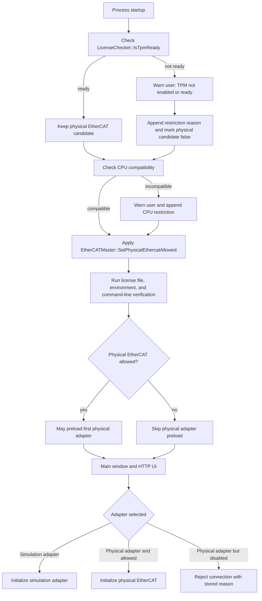
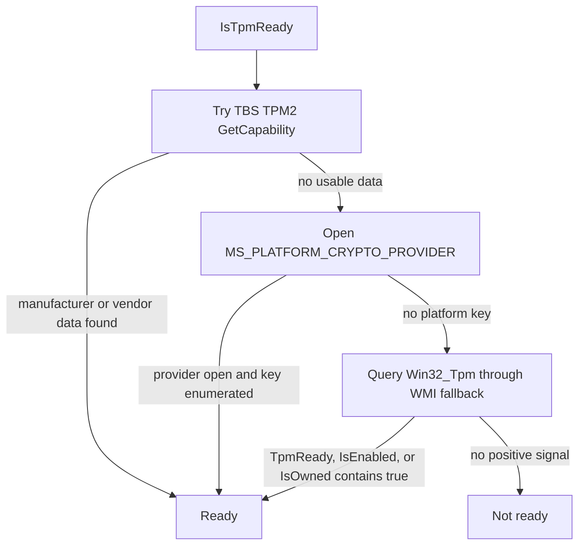
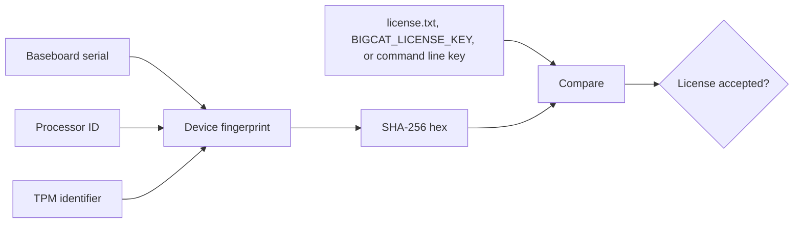

# TPM (Trusted Platform Module) requirement for BigCat

Updated: 2026-05-26

This document describes the current runtime requirement for TPM-backed physical
EtherCAT operation. It documents the implemented policy, not a complete platform
attestation design.

## Policy summary

BigCat can start without a ready TPM, but it must not open a physical EtherCAT
adapter in that state. A ready platform TPM is required before SOEM/Npcap is
allowed to touch a physical NIC. The built-in simulation adapter remains
available so development, UI checks, smoke validation, and non-hardware demos can
continue.

Physical EtherCAT is allowed only when all startup policy gates pass:

| Gate | Current implementation | Physical EtherCAT effect |
| --- | --- | --- |
| TPM readiness | `LicenseChecker::IsTpmReady()` in `src/app/main.cpp` | If false, show a warning and disable physical EtherCAT. |
| CPU compatibility | `CheckCpuCompatibility()` in `src/app/main.cpp` | If false, show a warning and disable physical EtherCAT. |
| Adapter selection | Simulation adapter names bypass physical NIC setup | Simulation can still run when physical EtherCAT is disabled. |
| License verification | `LicenseChecker::VerifyLicenseFromCmdLine()` | Separate license/trial flow. It does not make an unready TPM acceptable for physical EtherCAT. |

## Startup decision flow



The important safety point is ordering: the policy is set before the optional
startup preload and before the UI connection path can initialize a physical
adapter.

## TPM readiness probe

`LicenseChecker::IsTpmReady()` is stricter than the older
`LicenseChecker::IsTpmAvailable()` helper. It returns true when one of the
implemented Windows probes indicates usable TPM readiness:



Probe details:

| Probe | Code path | What it proves |
| --- | --- | --- |
| TBS TPM2 command | `QueryTpmViaTbs()` uses `TPM2_CC_GetCapability` | The TPM responds through Windows TPM Base Services. |
| NCrypt provider | `MS_PLATFORM_CRYPTO_PROVIDER` plus `NCryptEnumKeys()` | Windows exposes at least one platform-backed key name. |
| WMI fallback | `Win32_Tpm` properties queried by `QueryWmiString()` | Best-effort Windows management signal only. |

The probe is intentionally conservative for startup gating. It checks that TPM
functionality appears available and ready; it does not prove firmware integrity,
boot-chain integrity, or remote attestation status.

## License fingerprint relationship

TPM readiness and license validity are related but separate checks.



The normal fingerprint source is:

```text
BaseboardSerial | ProcessorId | TpmIdentifier
```

`TpmIdentifier` prefers TBS TPM data, then a platform-key public blob through
NCrypt, then WMI manufacturer/spec information. `GetDeviceFingerprintWmiOnly()`
exists for UI/debug display because it avoids direct TBS and NCrypt calls.

An invalid or missing license follows the product trial/timeout behavior. It is
not a TPM bypass and it does not override the physical EtherCAT policy gate.

## Physical EtherCAT enforcement points

| Layer | File | Responsibility |
| --- | --- | --- |
| Startup policy | `src/app/main.cpp` | Collect TPM/CPU restriction reasons and call `SetPhysicalEthercatAllowed()`. |
| Shared policy state | `src/ethercat/EtherCATMaster.cpp` | Store the allow flag and human-readable restriction reason. |
| Startup NIC warm-up | `src/app/main.cpp`, `src/ethercat/EtherCATMaster.Init.cpp` | Skip physical adapter preload when physical EtherCAT is disabled. |
| UI connect path | `src/ui/MainWindow.Connect.cpp` | Reject physical adapter selection with the stored reason. |
| Master initialization | `src/ethercat/EtherCATMaster.Init.cpp` | Refuse physical initialization if the policy disallows it. |
| Simulation path | `EtherCATMaster::IsSimulationAdapterSelection()` | Allow the simulation adapter even when physical EtherCAT is disabled. |

## Manual verification on Windows

Use `Get-Tpm` first because it is the clearest Windows-supported operational
check:

```powershell
Get-Tpm | Format-List *
```

For physical EtherCAT readiness, the important result is:

```text
TpmPresent : True
TpmReady   : True
```

Additional checks:

```powershell
# Device Manager should show:
# Security devices > Trusted Platform Module

# WMI management view used by Windows TPM tooling:
Get-CimInstance -Namespace root\cimv2\security\microsofttpm -ClassName Win32_Tpm |
    Format-List *
```

If TPM is present but not ready, check BIOS/UEFI settings such as Intel PTT,
AMD fTPM, or discrete TPM enablement, then initialize TPM through Windows
Security or `tpm.msc` according to the deployment policy. Clearing TPM can
destroy protected keys, so do it only when the machine owner has approved it.

## Development rules

- Do not add local bypasses in `src/app/main.cpp` to test physical EtherCAT on a
  non-TPM machine.
- Use the built-in simulation adapter for non-TPM development and CI/smoke
  validation.
- If the TPM policy changes, update this document and add a focused regression
  test or manual validation note for the physical EtherCAT rejection path.
- Keep TPM readiness separate from license validity in both code and user
  messages. A valid license must not silently enable physical EtherCAT when TPM
  readiness failed.

## Security limits

- TPM detection confirms that a TPM-like Windows interface responds. It is not a
  full attestation result.
- The current implementation does not verify measured boot, Secure Boot state,
  PCR values, or server-side attestation.
- Strong protection for production keys should use platform attestation and
  server-side verification in addition to local TPM presence checks.
